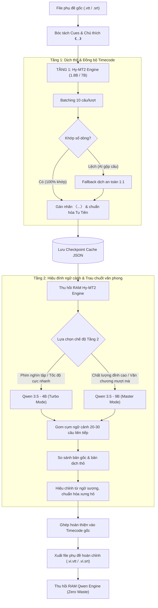

# 🏛️ KIẾN TRÚC PIPELINE DỊCH PHỤ ĐỀ 2 TẦNG (HYBRID TWO-STAGE PIPELINE)
## TENCENT HY-MT2 & ALIBABA QWEN 3.5

Tài liệu đặc tả kiến trúc kỹ thuật của hệ thống dịch phụ đề phim chuyên nghiệp đa tầng, kết hợp mô hình dịch máy dịch sát nghĩa (Machine Translation) và mô hình ngôn ngữ lớn hiểu sâu ngữ cảnh (Large Language Model Context Refiner).

---

## 📐 1. Sơ Đồ Luồng Xử Lý Tổng Thể (Pipeline Workflow)

```text
[Phụ đề gốc (.vtt / .srt)] 
     │
     ▼
[TẦNG 1: Tencent Hy-MT2 (1.8B / 7B)] ──► Dịch thô sát nghĩa + Giữ 100% timecode & chú thích 〈...〉
     │                                    (Hỗ trợ Batch 10 câu/lô + Fallback 1:1 an toàn)
     │
     ▼ 
[Checkpoint Cache (.stage1_cache.json)] ──► Lưu bản dịch thô xuống đĩa, tránh dịch lại lãng phí
     │
     ▼
[TẦNG 2: Alibaba Qwen 3.5 (4B / 9B)] ──► Gom batch 20–30 câu: Trau chuốt câu cú, đại từ, sửa sượng
     │
     ├──► 🚀 Chế độ Turbo (Qwen 3.5 - 4B) : ~20-30 tokens/s (Dành cho cày phim nghìn tập)
     ├──► 👑 Chế độ Master (Qwen 3.5 - 9B): ~10-15 tokens/s (Dành cho tập quan trọng / chất lượng cao)
     │
     ▼
[Phụ đề hoàn thiện (.vi.vtt / .vi.srt)] ──► Xuất phụ đề tiếng Việt mượt mà, đúng chuẩn điện ảnh
```

---

## 🔄 2. Biểu Đồ Trạng Thái Chi Tiết (Mermaid Diagram)



---

## ⚙️ 3. Chi Tiết Kỹ Thuật Từng Tầng

### 🎯 TẦNG 1: Dịch sát nghĩa & Khóa mốc thời gian (Hy-MT2)
* **Nhiệm vụ:**
  1. Bảo toàn 100% từng mili-giây mốc thời gian (`00:00:01.050 --> 00:00:03.050`) và định dạng vị trí hiển thị (`position:50% line:20% align:center`).
  2. Bóc tách và định dạng chuẩn các ô sub chú thích nhân vật/hệ thống từ `《...》` sang `〈...〉` trong tiếng Việt.
  3. Áp dụng bảng từ vựng vai vế (`vocabulary.txt`) với thuật toán **Dynamic Term Filtering** tiết kiệm 95%+ token.
* **Cơ chế Batching thông minh:**
  * Gom 10 câu phụ đề vào một lượt suy luận (`batch_size = 10`), tăng tốc độ xử lý gấp **3x – 5x**.
  * Tích hợp cơ chế **Safety Fallback**: Nếu mô hình nuốt câu làm lệch số dòng, lập tức chuyển riêng 10 câu đó về dịch 1:1, triệt tiêu mọi rủi ro lệch sub.
* **Lưu trữ Checkpoint (Cache Layer):**
  * Lưu kết quả dịch thô vào file `.stage1_cache.json`.
  * Nếu quá trình ở Tầng 2 cần chạy lại (hoặc đổi từ bản 4B sang 9B), hệ thống phục hồi kết quả Tầng 1 chỉ trong **1 mili-giây** mà không cần dịch lại từ đầu.

---

### 🧠 TẦNG 2: Hiệu đính ngữ cảnh & Tinh chỉnh văn phong (Qwen 3.5)
* **Nhiệm vụ:**
  1. Đọc hiểu mạch đối thoại xuyên suốt của một phân cảnh gồm 20–30 câu liên tiếp.
  2. Phát hiện và sửa các lỗi dịch thô (literal translation) mà các mô hình dịch máy thường gặp.
  3. Đảm bảo đại từ xưng hô đồng nhất giữa các nhân vật (cha-con, sư huynh-sư đệ, phu thê, đối thủ).
* **Hai chế độ linh hoạt:**
  * **🚀 Chế độ Turbo — Qwen 3.5 4B (GGUF Q4_K_M):**
    * Dung lượng file: `~2.8 GB` | Chiếm RAM: `~4.5 GB`.
    * Tốc độ suy luận: `~20 – 30 tokens/giây` trên CPU Intel i5-10400F.
    * Ứng dụng: Chuyên dùng để cày hàng loạt các bộ phim dài tập (hàng trăm đến hàng nghìn tập) trong thời gian ngắn nhất.
  * **👑 Chế độ Master — Qwen 3.5 9B (GGUF Q4_K_M):**
    * Dung lượng file: `~5.5 GB` | Chiếm RAM: `~7.5 GB`.
    * Tốc độ suy luận: `~10 – 15 tokens/giây` trên CPU Intel i5-10400F.
    * Ứng dụng: Chuyên dùng cho các tập phim cao trào, phim lẻ chiếu rạp, hoặc khi người dùng đòi hỏi văn phong trau chuốt, giàu cảm xúc nhất.

---

## 💾 4. Chiến Lược Quản Lý Bộ Nhớ (Zero RAM Waste)

Thiết kế tối ưu cho cấu hình máy **Intel Core i5-10400F + 32 GB RAM**:

1. **Khởi chạy tuần tự (Sequential Pipeline):**
   * Không chạy song song hai mô hình cùng lúc.
   * **Giai đoạn 1**: Nạp Hy-MT2 vào RAM $\rightarrow$ Dịch xong toàn bộ các câu của tập $\rightarrow$ Lưu cache $\rightarrow$ Tự động ngắt và thu hồi 100% RAM của Hy-MT2.
   * **Giai đoạn 2**: Nạp Qwen 3.5 (4B hoặc 9B) vào RAM $\rightarrow$ Đọc dữ liệu từ cache $\rightarrow$ Hiệu đính theo từng batch 20-30 câu $\rightarrow$ Xuất file hoàn chỉnh $\rightarrow$ Ngắt và thu hồi RAM của Qwen 3.5.
2. **Mức tiêu thụ tài nguyên thực tế:**
   * Giai đoạn 1: Chiếm khoảng `~1.6 GB` (với 1.8B) hoặc `~5.5 GB` (với 7B).
   * Giai đoạn 2: Chiếm khoảng `~4.5 GB` (với 4B) hoặc `~7.5 GB` (với 9B).
   * **Tổng mức chiếm dụng đỉnh điểm không bao giờ vượt quá 8 GB RAM**, máy tính luôn dư thừa hơn 24 GB RAM để làm việc khác hoặc treo máy hàng tuần liên tục mà không lo tràn RAM.

---

## 🖥️ 5. Hướng Dẫn Sử Dụng Trong CLI & Code

### Cú pháp dòng lệnh dự kiến:
```powershell
# 1. Dịch chuẩn chất lượng cao nhất (Tầng 1: 7B + Tầng 2: 9B Master):
cargo run --release --example demo_translate -- --stage2-9b

# 2. Dịch tốc độ công nghiệp cho phim nghìn tập (Tầng 1: 1.8B + Tầng 2: 4B Turbo):
cargo run --release --example demo_translate -- --1.8b --stage2-4b input

# 3. Chỉ chạy dịch nhanh Tầng 1 (Bỏ qua Tầng 2):
cargo run --release --example demo_translate -- --1.8b input
```

